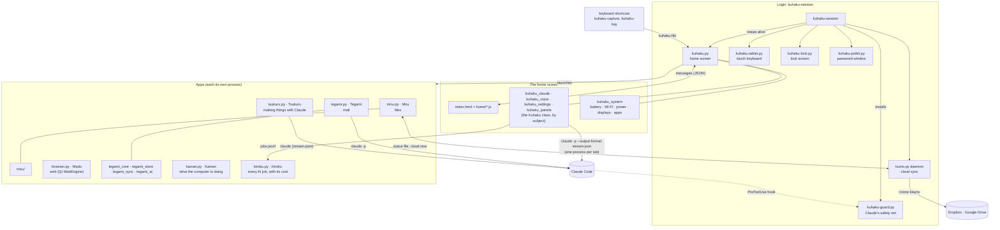

# How Kūhaku is built

Kūhaku is a set of small Python programs on top of a normal Debian/Linux Mint desktop (XFCE, X11).
Each visible app is a GTK window holding a web page (WebKitGTK): the page draws, Python does the
work. Claude Code does what people ask, in the background, through its command line.

There is no build step and no framework. Every file in the project root is either an app you can
start, a module one of them imports, or a small shell script the session or a key binding runs.

## The pattern every app follows

1. **A GTK window with one WebKit view.** The page lives beside the app (`index.html` + `home/`,
   `miru/`, `kansei/`, `kiroku/`, `mail/`, `ide/`) as plain HTML, CSS and classic scripts. No bundler.
2. **Page to Python**: the page posts JSON to `window.webkit.messageHandlers.<app>`. Python looks the
   message's `type` up in a `MESSAGES` table and calls one method. The home screen's panels (Wi-Fi,
   battery, calendar, Settings…) go one step further: `{"type": "panel", "action": …}` is looked up in
   `kuhaku_panels.PANEL` and runs on a worker thread.
3. **Python to page**: `send(name, payload)` calls a global function on the page
   (`window.showAnswer`, `window.setTabs`, `window.browse`…) with JSON.
4. **Slow work never blocks the window**: it runs on a thread, and its result comes back with
   `GLib.idle_add`.
5. **Best effort, never silent**: what may fail without harm (a missing battery, a file not there yet)
   is caught and written down with `kuhaku_log.report()`, once per place and error, in
   `~/.local/state/kuhaku/logs/<app>.log`. A test fails on any `except Exception: pass`.

## The home screen and Claude

`kuhaku.py` is the window: page, keys, menus, the FIFO that keyboard shortcuts write to. The `Kuhaku`
class is assembled from mixins kept by subject:

| Module | What it holds |
|---|---|
| `kuhaku_claude.py` | Questions as jobs. Each tab runs `claude -p … --output-format stream-json` in the background; `jobs.py` decides how many may run (memory, plan limits) and keeps the line; `kuhaku_system.describe()` turns the event stream into the plain words shown while Claude works; the final answer is saved and shown. |
| `kuhaku_voice.py` | Dictation (Whisper, offline, `transcribe.py`) and spoken conversations (Piper, `speak.py`). |
| `kuhaku_settings.py` | Reading and writing every preference on the Settings page. |
| `kuhaku_panels.py` | The panels' actions, one small handler each. |
| `kuhaku_system.py` | Plain functions that read and change the computer through its own tools (`nmcli`, `bluetoothctl`, `xfconf-query`, `xrandr`, `wmctrl`). No window code. |
| `kuhaku_config.py` | Where things live, the defaults, and the instructions Claude is given. |
| `kuhaku_base.py` | `Home`, the base of every mixin: the state and methods they share, declared once so the type checker and the reader both know them. |

Claude runs with the permissions chosen in Settings ("Anything, without asking" by default).
Underneath sits **`kuhaku-guard.py`**, a Claude Code `PreToolUse` hook installed into
`~/.claude/settings.json` at every login. It stops only what cannot be undone: wiping disks,
deleting whole folders outright (Claude is sent to the Trash instead), force-pushing over `main`,
sending secrets over the network, adding login keys. It runs for every Claude session on the
computer, not only the home screen's.

## Files and state

| Where | What |
|---|---|
| `~/Projects/kuhaku-linux` | This project: the only place Kūhaku is changed. |
| `~/.local/share/kuhaku` | The running copy, written only by `dev/install` (which refuses to overwrite changes made there). Also holds what is never in git: the dictation venv, face data, models, Mado's profile. |
| `~/.config/kuhaku/` | Choices: `config.json`, cloud folders, accounts, `rclone.conf` (mode 600). |
| `~/.local/state/kuhaku/` | What changes as it runs: tabs, answers, `claude.log`, `jobs.jsonl` (for Kiroku), cloud sync status, `logs/`. |
| `system/` | Copies of the system settings Kūhaku changes (`kuhaku-backup` refreshes them, with the home folder written as `$HOME`). |
| `os/` | Kūhaku as its own system: the Debian package and the install image. |

## Checks

`dev/check` runs, in order: compile, `ruff format --check`, `ruff check`, `mypy` (every Python file),
the unit tests in `tests/` (logic, the guard, cloud sync against a real rclone if present, static
rules for the whole project), every page loaded off-screen for script errors, and `uitests/`, which
drive the pages with clicks and keys and compare screenshots. `dev/check quick` (no pages) runs
before every commit; GitHub runs all of it on every push.
